# ai-reel-gen

Short narrated explainer reels (9:16, Spanish), animated in code with [Remotion](https://remotion.dev) in a halftone
paper-collage style, narrated with ElevenLabs, made with Claude Code.

## Contents

- [Features](#features)
  - [Video library](#video-library)
  - [Video workspace](#video-workspace)
  - [Claude panel](#claude-panel)
  - [Mi cuenta](#mi-cuenta)
  - [Ideas de contenido](#ideas-de-contenido)
  - [Automatizaciones](#automatizaciones)
  - [Inspiración](#inspiración)
  - [Styles and formats](#styles-and-formats)
  - [Voice settings](#voice-settings)
  - [Agent settings](#agent-settings)
  - [Requirements check](#requirements-check)
- [Repository layout](#repository-layout)
- [Setup](#setup)
- [New reel](#new-reel)
- [Studio (local UI)](#studio-local-ui)
- [Desktop app and installer](#desktop-app-and-installer)
- [Rebuild a reel's media](#rebuild-a-reels-media)
- [License](#license)

## Features

Reel Studio is a desktop app where each channel is a project and each video has its own Claude Code agent. The
screenshots come from a real project, with the account's name and photo blurred; the app's interface is in Spanish.

### Video library

Every video in the project, with its style, length, number of versions and how far along it is. The sidebar lists each
video's agent and what it needs from you, and the selector at the top switches between projects.

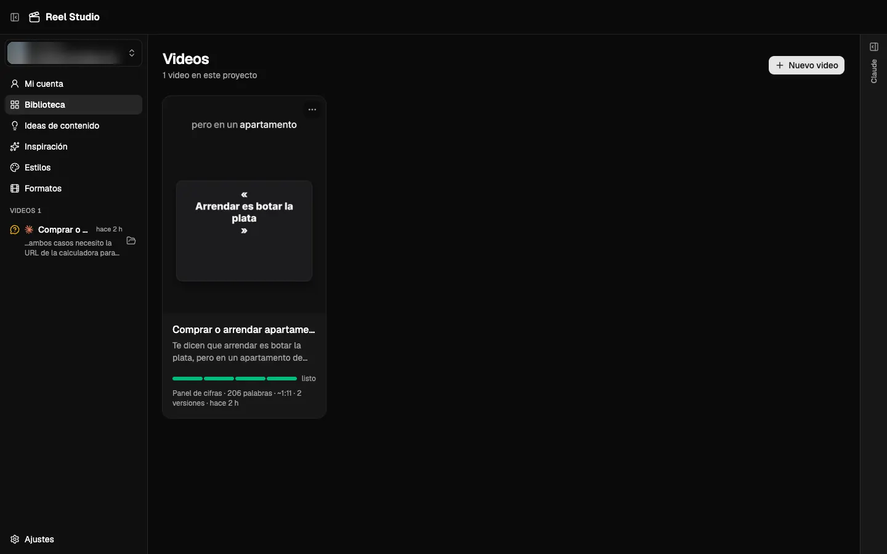

### Video workspace

Watch every rendered version and jump through the acts on the timeline. Edit the script, split into hook, context,
development and the rest, then press **Comentar aquí** to send the agent a note about that exact moment. The tabs under
the player hold the Instagram caption, ready to copy, and the fields for a comment-to-DM automation.

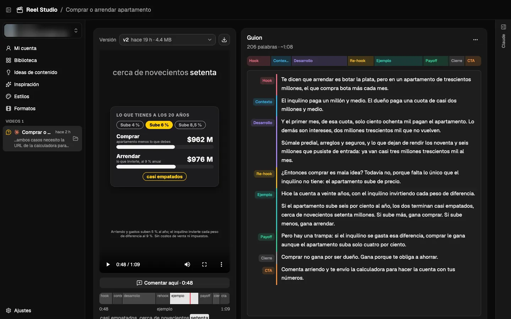

### Carousels

Instagram carousels (still slides, 4:5, 1080×1350) live in the same library, under **Publicaciones**, next to the videos;
an icon tells them apart and **Nuevo carrusel** starts one from an idea, a saved idea, the audience profile or a video's
script. Its agent writes and draws each slide in Remotion in the carousel's style (`carousel-template/`, skill
`carousel`). The editor shows the selected slide large with the others in order: drag to reorder, add, duplicate or
remove, and press **Comentar aquí** on a slide; comments follow the slide by its id even after it moves. Every render is
a fixed version (`out/vN/`) and **Exportar** downloads its numbered images with the caption and credits. Publishing
carousels to Instagram is not in the app yet.

### Claude panel

Ask for a video in plain language and follow each step the agent takes while it researches, writes and renders. Each
message includes where you are in the app, so "esto" or "aquí" needs no explaining. A selector in the chat sets how much
the agent can do without asking, and it can also use Chrome with your signed-in sessions.

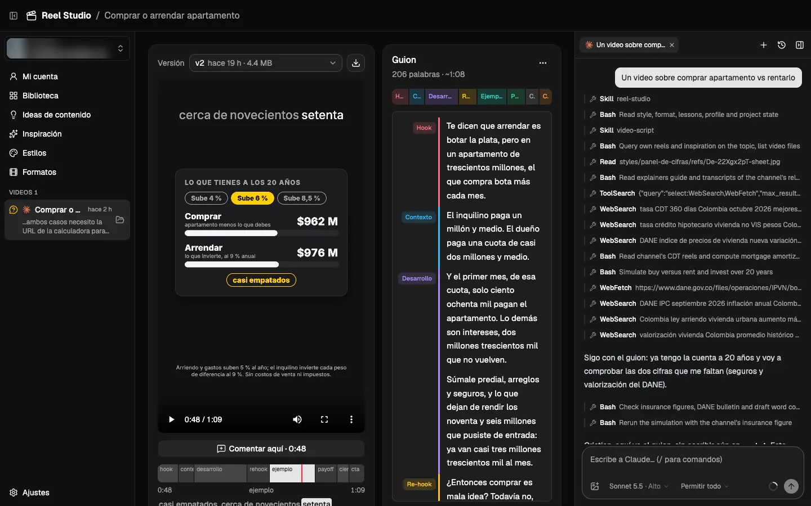

### Mi cuenta

Your Instagram reels and their numbers: the best performers, each reel's views against your median, likes, comments,
length and date. Search through captions, transcripts and analyses, or have the agent analyse your reels and propose
new ideas.

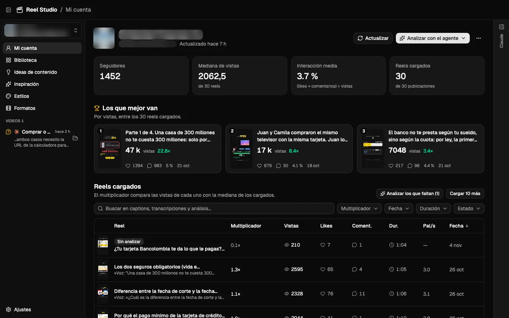

### Ideas de contenido

A board for each project's video ideas, with content verticals on top and lists you can drag cards between. The agent
can change it too, and you can attach an idea to your next conversation.

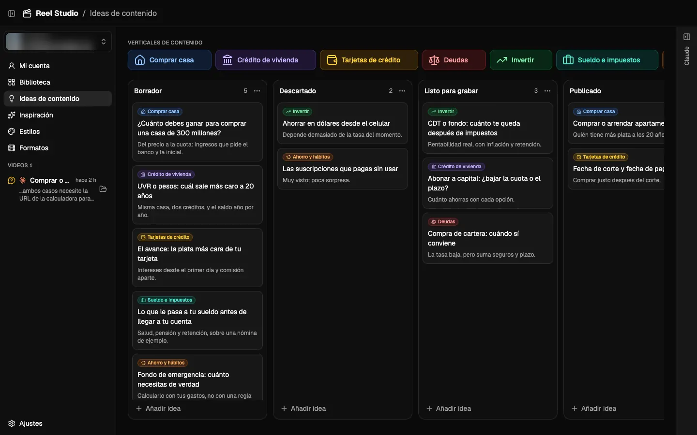

### Automatizaciones

Flows that run on a schedule, per project: a cron expression and a list of steps. A step is either a prompt for an agent
that runs without you and can't ask anything, an update of Mi cuenta (your newest reels with their numbers, and your
profile), an update of one of its reels (its numbers and metadata), or an update of an account scanned in Inspiración
(its newest reels with their numbers, and its profile; of those reels, the ones missing it and no longer than the step's
maximum duration, up to 3 minutes, get their video, frames, transcript and analysis; the rest only their numbers). These
updates are charged to your scraper's balance, and that analysis to your agent's subscription. Each step starts when the
previous one finishes, and a step that fails stops the flow. They only fire while Reel Studio is open and the computer
is awake; a time missed is not made up for later. The run's history shows how each step went, and an agent's
conversation opens from there. These agents can't use Chrome.

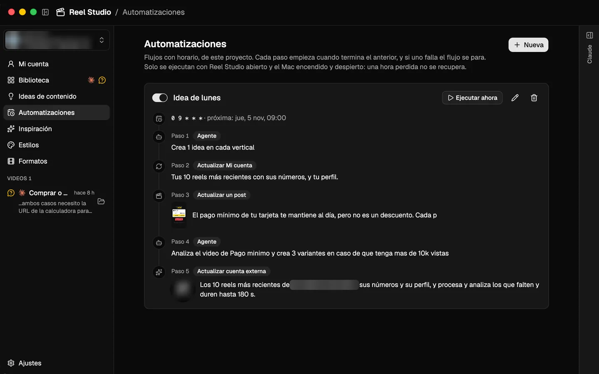

### Inspiración

Study other accounts' reels. Add an account or a reel link and the app downloads, transcribes and analyses it: hook,
structure, pace, visuals and call to action. You can then use a reel as a reference in your next message.

### Styles and formats

A style is how a video looks; a format is how it's made. Three styles ship with the app, and the agent can help you
create more from your own references. Formats cover animation over a generated voice, animation over your recorded
voice, and you talking to camera with animations.

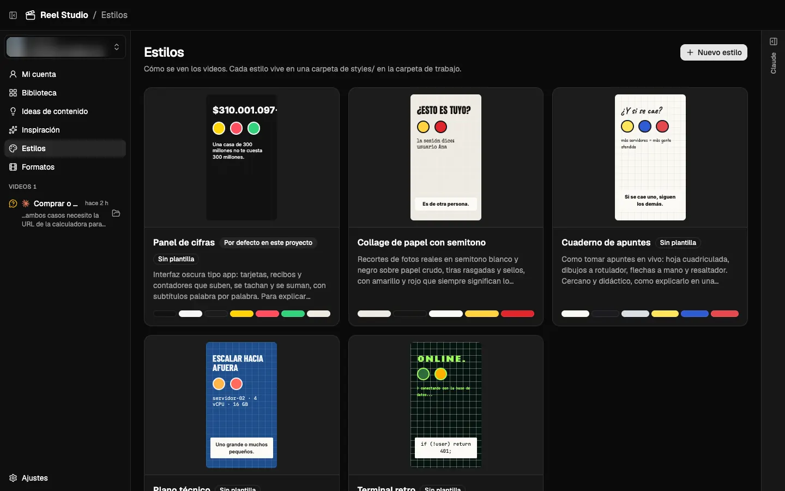

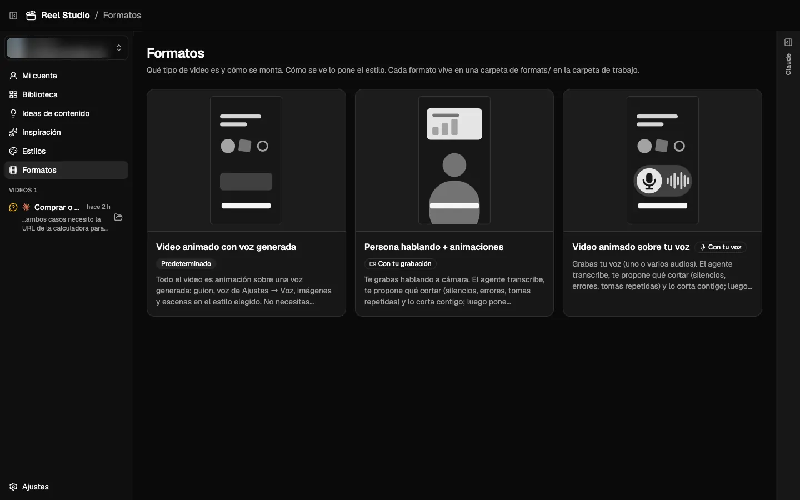

### Voice settings

Narration comes from ElevenLabs, and you can turn it off. Pick the voice from your ElevenLabs account, including your
own clone, then set the model, speed, stability, similarity and style. A video can use a different voice from its own page.

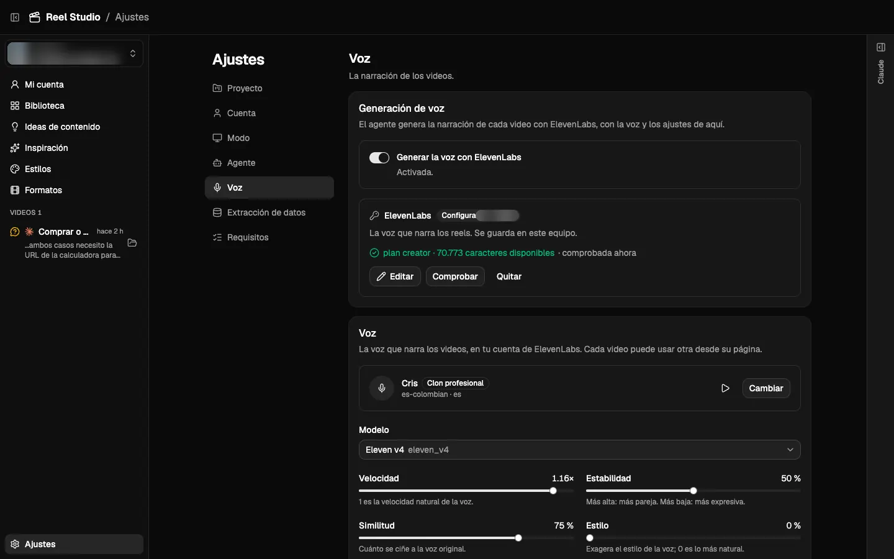

### Agent settings

Agents use the tool installed on your computer, such as Claude Code or Codex, with your own login, so no API key is
needed. Choose the default tool, see how much of your plan you've used, and decide for each project whether the agent can
use Chrome.

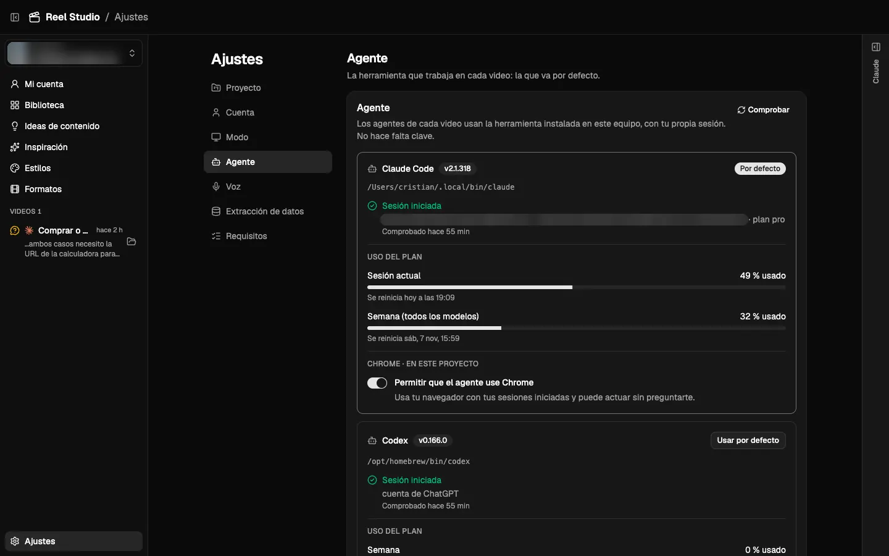

### Requirements check

The app checks what this computer needs (Node, ffmpeg, Python and its packages, transcription) and shows what's missing.

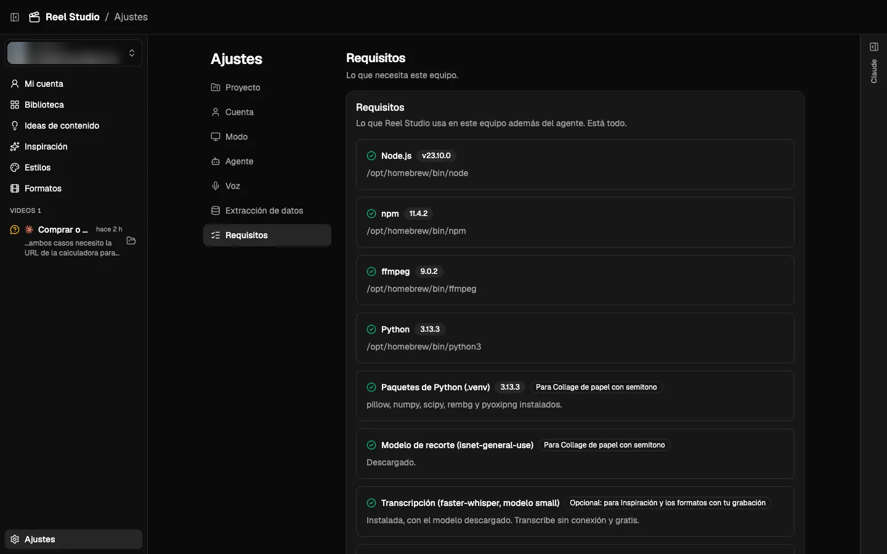

## Repository layout

```
.claude/skills/   Claude Code skills: reel-studio (the process, any style) and the cstack video skills
styles/           visual styles: style.json, and for collage-semitono its SKILL.md and examples
LESSONS.md        local lessons and preferences (gitignored; starter in studio/workspace/)
template/         starting point for a new reel (Remotion + collage kit + paper-foley mix)
carousel-template/ starting point for a new carousel (Remotion stills: render.sh → out/vN/, preview.sh)
tools/            shared Python: cutout.py (photo → halftone cutout), image search (commons.py, openverse.py,
                  pexels.py, pixabay.py, unsplash.py), social.py (Instagram scraper, via the studio),
                  tts.py (ElevenLabs, voice from the project's config/voice.json),
                  el_words.py (word timings), standin_words.py, sheet.py
refs/             local style references, not in this repository (third-party images, approved frames)
projects/<id>/    one per channel (the studio's project selector): videos/<slug>/ (one folder per reel), config/
                  (profile.json, voice.json, account.json, images.json, social.json, chat.json), ideas.json,
                  account/ (Mi cuenta), inspiration/ (other accounts' reels) and its conversations.
                  Customer data: ignored by Git, never shipped with the app.
config/           local preferences for projects without their own images.json, social.json (gitignored)
.reel-studio/     the studio's SQLite index of all of it, every project (index.sqlite; tools/studio_sql.py)
scripts/          new-video.sh (into the open project, REEL_STUDIO_PROJECT), new-carousel.mjs
```

## Setup

This is the application source repository. Customer projects, generated videos, configuration, ideas,
accounts, conversations, custom styles and personal lessons stay on disk and are not committed here.
Only the built-in styles (`collage-semitono`, `cuaderno-apuntes`, `panel-de-cifras`, `plano-tecnico`) ship with the application.
Use a separate repository if you explicitly want to version your content. Ignoring existing data does not
remove it from older commits.

```
cp .env.example .env            # add ELEVENLABS_API_KEY
python3 -m venv .venv && .venv/bin/pip install -r tools/requirements.txt
```
Needs Node 22.18+ (or 23.6+: the studio runs its TypeScript directly with Node), ffmpeg, Python 3.11+.

## New reel
```
scripts/new-video.sh my-topic
```
Then follow `.claude/skills/reel-studio/SKILL.md` with the style's skill (or ask Claude Code: "haz un reel sobre …").

## Studio (local UI)
```
cd studio && npm install && npm start     # → http://localhost:4000
```
Browse reels, watch every rendered version with the acts timeline, edit the script (`audio/vo.txt`), drafts
(`drafts/*.txt`), `CREDITS.md` and the Instagram caption (`caption.md`). It reads the repo directly and refreshes
live when files change, so edits made by Claude Code show up as they happen. It listens on the local network
(`http://<this-mac-ip>:4000`); `HOST=127.0.0.1 npm start` keeps it to this machine.

On the left, an **agents sidebar** (like a conductor's board) lists each video's agent grouped by what it needs
from you: *te necesitan* (ended on a question you haven't answered), *trabajando* (Claude or a pipeline job running,
with its tool or progress), *para revisar* (finished, not seen yet), *con error*, and the rest. One agent per video;
several videos in parallel. "Seen" is stored server-side, and the tab title counts the agents waiting on you.

The **Claude panel** on the right is always there (collapse it to a rail with ⌘J; the rail shows when Claude is
working or has replied) and follows you: inside a video it is that video's conversation, in the library a general one
(ideas, scripts, creating a new video). They are Claude Code sessions (`claude -p`, your own login, bypass permissions)
run in the repo root, so they follow CLAUDE.md, the reel-studio skill and the video's style. Every message carries where you are in the
UI (page, version in the player, second and act, open tab, unsaved script), so "esto" or "aquí" needs no explaining. Pause the video and press **Comentar aquí** to attach
a note to that instant: Claude gets the time, act, spoken words and a grab of the frame. Transcripts live in
each project's `.reel-studio/chats/` (gitignored); `claude --resume <id>` (shown under the input) continues the same session in a terminal.

**Projects**: the selector at the top of the sidebar switches channel. Each project (`projects/<id>/`) has its own
videos, Mi cuenta, profile, voice and conversations; Inspiración, keys, image sources, the scraper, styles, tools and
skills are shared. A workspace from before projects gets everything moved into `projects/principal/` when opened.

**Ideas de contenido** is each project's board of video ideas (`projects/<id>/ideas.json`), like Trello: content verticals on top
(each with a name, a description and an icon), as cards that also filter and tint it, and lists of cards you drag within and between lists. It starts with Borrador, Descartado, Listo
para grabar and Publicado; add, rename, reorder or delete them. The agent can do all of it (`tools/ideas.py`). **Adjuntar al chat**, in an open idea, adds it to your next message in the general
conversation, and the agent gets its title, notes, list and vertical as they are on the board.

**Inspiración** studies other accounts' reels. Add `@accounts` or reel URLs: they're downloaded with the scraper chosen in
Ajustes → Extracción de datos: Apify's Instagram Reel Scraper (`APIFY_TOKEN`; charges per reel, a monthly plan past
the free 5 US$) or ScrapeCreators (`SCRAPECREATORS_API_KEY`; prepaid credits that don't expire). The studio shows the
most it can cost before starting. Then they're transcribed on this machine with faster-whisper (Ajustes → Requisitos → Transcripción; free, offline), and Claude
analyses each reel (hook, structure, pace, visuals, CTA) and each account (what beats its median views). Everything
goes to the project's `inspiration/` (gitignored), so each project studies its own accounts; the MP4 is deleted once the cover, frame sheets and transcript are out of it.
**Usar como referencia** attaches a reel to your next message in the general conversation.

**Mi cuenta** is the project's Instagram account (`projects/<id>/config/account.json`): your newest reels with their numbers (views,
multiplier over the median, engagement), downloaded with the same scraper into the project's `account/` (gitignored), the best of
them on top, and **Analizar con el agente**, a menu that opens a general conversation to analyse the loaded reels, propose new ideas, create variants of the best ones or analyse the whole account (with what's already downloaded: the agent asks before spending on the scraper or on analysing more). Each reel can also be
analysed like Inspiración's (**Analizar** on its card, or all those not analysed yet): transcript, frames and the agent's
analysis against your own numbers, with its state in the table. The agent can use the scraper itself with
`tools/social.py` (your reels, another account's, one reel, a profile; each call prints what it cost), and analyse your
reels with `social.py analyse` (it asks before more than 5), both through the running studio.

The **pipeline** bar runs the skill's mechanical steps without Claude, with live progress and cancel: voice
(ElevenLabs, asks first: it spends credits), board (one still mid-act → `out/board-N/`), mix, render (`render.sh` with
`RENDER_LOG=info` for the frame counter; one render or board at a time across reels) and mute-test sheets. When a step
finishes, one button hands the judgement part to Claude (re-time after a new voice, review a board, run the mute test,
check and commit a render). The player's **En vivo** option plays the reel's current code with `@remotion/player`
(no render); edits to a video's `src/` hot-reload it.

## Desktop app and installer
```
cd studio && npm run desktop     # the app from the repo (uses the server on :4000 if one is running)
cd studio && npm run dist        # → studio/dist/Reel Studio-<version>-arm64.dmg (macOS, Apple Silicon)
```
The installed app carries the template, tools, styles, skills and agent instructions; on first run its welcome
page asks for a workspace folder and copies them there (this repo can be chosen as it is: nothing in it is
replaced), then checks Claude Code, the requirements (Node, npm, ffmpeg, Python, the .venv), keys, profile and
voice. It is ad-hoc signed, not notarized: on another Mac open it the first time with right click → Abrir. It
listens only on this machine (`HOST=0.0.0.0` opens it to the network).

## Rebuild a reel's media
Renders (`out/`), WAVs in `public/` and downloaded photos (`assets/src/`) are not committed.
```
cd projects/<id>/videos/<slug> && npm install
ffmpeg -y -i audio/vo.mp3 -ar 48000 public/vo.wav
../../../../.venv/bin/python audio/mix.py
CONCURRENCY=3 ./render.sh <name>
```
Image credits for each reel are in its `CREDITS.md`.

## License

[MIT](LICENSE). Some skills come from third parties: see [THIRD_PARTY_NOTICES.md](THIRD_PARTY_NOTICES.md).
